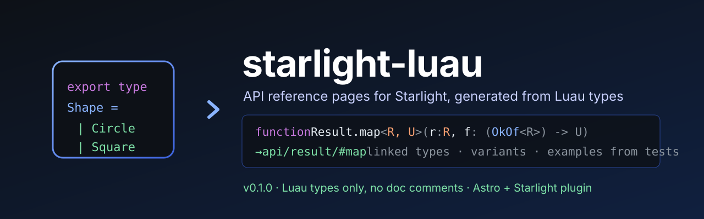

<p align="center">
  
</p>

<p align="center">
  <a href="https://github.com/Braden1996/starlight-luau/actions/workflows/ci.yml"></a>
  <a href="https://www.npmjs.com/package/starlight-luau"></a>
  <a href="LICENSE"></a>
  
  
</p>

**A [Starlight](https://starlight.astro.build) plugin that turns [Luau](https://luau.org) modules into an API
reference, using only their types.** You do not write doc comments. Signatures, generics, tagged-union variants and
cross-links come from the code. Hand-written Markdown adds explanations where they help. The names of your unit tests
become the behaviour descriptions, and the test code becomes the examples.

```luau
--!strict
export type Ok<T> = { read kind: "Ok", read value: T }
export type Err<E> = { read kind: "Err", read error: E }
export type Result<T, E> = Ok<T> | Err<E>

local Result = {}

function Result.map<R, U>(result: R, f: (value: OkOf<R>) -> U): Result<U, ErrOf<R>>
	...
end
```

That module becomes a page with:

- a section per type, including the variants table for `Result` (`"Ok"` → `Ok<T>`, `"Err"` → `Err<E>`);
- the `map` signature with every type name linked to its definition;
- a note that `R` is inferred as a whole type and read through `OkOf` and `ErrOf`, which link to the type functions
  that compute them;
- each test whose name mentions `map`, shown as a collapsible example.

## Contents

- [Install](#install)
- [Wire it into a Starlight site](#wire-it-into-a-starlight-site)
- [Options](#options)
- [Prose](#prose)
- [Examples from tests](#examples-from-tests)
- [What is rendered](#what-is-rendered)
- [How it works](#how-it-works)
- [Why a plugin and not a CLI](#why-a-plugin-and-not-a-cli)
- [Development](#development)
- [Licence](#licence)

## Install

The plugin needs two things: the package itself, and Luau's own `luau-ast` executable on `PATH` at build time.

1. Add the package from [npm](https://www.npmjs.com/package/starlight-luau). It ships TypeScript sources, which Astro
   loads directly, so it has no build step:

   ```sh
   bun add starlight-luau
   ```

   Each release is also attached to its [GitHub release](https://github.com/Braden1996/starlight-luau/releases) as a
   tarball with a `SHA256SUMS` file, and npm versions carry provenance from the release workflow.

2. Pin `luau-ast`. It is part of every [Luau release](https://github.com/luau-lang/luau/releases) (0.747 or later).
   With [mise](https://mise.jdx.dev), add it to `mise.toml` and lock its checksums:

   ```toml
   [tools]
   "github:luau-lang/luau" = "0.747"
   ```

   ```sh
   mise install && mise lock
   ```

   In CI, `jdx/mise-action` puts it on `PATH`. To use a binary elsewhere, set the `luauAst` option to its path.

Requirements: Astro 7 and `@astrojs/starlight` 0.43 or later, on Node 26 or Bun 1.4.

## Wire it into a Starlight site

```ts
// astro.config.ts
import starlight from "@astrojs/starlight";
import { defineConfig } from "astro/config";
import starlightLuau from "starlight-luau";

export default defineConfig({
  integrations: [
    starlight({
      title: "My library",
      sidebar: [{ label: "Guides", autogenerate: { directory: "guides" } }],
      plugins: [
        starlightLuau({
          source: "../src",
          prose: "../docs/api",
          sourceUrl: "https://github.com/me/my-library/blob/main/src/{file}#L{line}",
        }),
      ],
    }),
  ],
});
```

Then add the generated folder to `.gitignore`. The pages are rebuilt on every `astro dev` and `astro build`:

```gitignore
src/content/docs/api/
```

The plugin writes one page per module plus an overview to `src/content/docs/api/`. It also adds an "API reference"
group to the sidebar and loads its stylesheet. During `astro dev`, editing a module or one of its spec files restarts
the server and regenerates the pages.

## Options

| Option       | Default                                | Meaning                                                                                                                          |
| ------------ | -------------------------------------- | -------------------------------------------------------------------------------------------------------------------------------- |
| `source`     | (required)                             | The folder that holds the Luau modules, relative to the Astro project root.                                                      |
| `include`    | `["**/*.luau"]`                        | Globs, relative to `source`, of the files to document.                                                                           |
| `exclude`    | `["**/*.spec.luau", "**/*.test.luau"]` | Globs to leave out.                                                                                                              |
| `modules`    | every matched file, sorted             | Module names (file paths without the extension; `init.luau` takes its folder's name) to document, in sidebar order.              |
| `output`     | `"api"`                                | The folder under `src/content/docs` to generate. It must be empty or already generated by this plugin; anything else is refused. |
| `title`      | `"API reference"`                      | The sidebar group label and overview page title.                                                                                 |
| `prose`      | none                                   | A folder of hand-written Markdown, relative to the Astro project root. See [Prose](#prose).                                      |
| `examples`   | on, with the patterns below            | `false`, or `{ patterns, testFunctions }`. See [Examples from tests](#examples-from-tests).                                      |
| `sourceUrl`  | none                                   | A link template for "Source" lines; `{file}` is the path relative to `source`, `{line}` the line number.                         |
| `luauAst`    | `"luau-ast"`                           | The `luau-ast` executable to run.                                                                                                |
| `printWidth` | `80`                                   | The width at which signatures break onto several lines.                                                                          |
| `sidebar`    | `true`                                 | Add the sidebar group. Ignored when the site has no explicit `sidebar`, because Starlight then lists every page itself.          |

The package also exports `generateApi`, which returns the pages as `{ path, content }` records without writing them.
Use it to build your own tooling.

## Prose

Prose is optional Markdown that is kept separate from the code. Given `prose: "../docs/api"`:

| File                          | Placed                                                                        |
| ----------------------------- | ----------------------------------------------------------------------------- |
| `docs/api/Result.md`          | At the top of the `Result` page. Its first paragraph is the page description. |
| `docs/api/Result/map.md`      | Under the `map` signature.                                                    |
| `docs/api/Result/types/Ok.md` | Under the `Ok` type.                                                          |

Front matter in prose files is ignored. A prose file that names a function or type that does not exist produces a
build warning, so renames do not leave orphaned text behind.

## Examples from tests

With examples on, the plugin reads each module's colocated spec file. The default patterns are
`{dir}/{name}.spec.luau` and `{dir}/{name}.test.luau`, resolved against `source`. For specs kept elsewhere, use
something like `patterns: ["../tests/spec/{name}.spec.luau"]`.

A test is any call such as `t.test("name", function() ... end)` or `it("name", function() ... end)` whose first
argument is a string literal. `testFunctions` (default `["test", "it"]`) names the callees. Each test is listed under
the functions its name mentions, so "map and mapErr touch one side" appears under both `map` and `mapErr`. When a name
mentions no function, the test is listed under every function its body uses (`Module.fn`). The test name is the
summary, and the dedented test body is the example code.

## What is rendered

Everything comes from the Luau AST (`luau-ast`), checked against the fixture library in [fixtures/](fixtures) and its
[expected output](fixtures/expected):

- **Functions:** every `function Module.name` and `function Module:method` on the table the module returns, in source
  order, with generics, generic packs, typed and untyped parameters, varargs (`...: T`, `...: A...`) and returns
  (`T`, `(A, B)`, `...T`).
- **Types:** every `export type` and `export type function`. Private aliases and type functions are included too when
  the public API refers to them, and marked as not exported.
- **Type syntax:** references (including `Module.Type` from `require`d modules), string and boolean singletons,
  unions, `?`, intersections, tables with `read`/`write` properties and indexers, `{ T }` arrays, function types with
  named or unnamed parameters, type packs, generic defaults, `typeof(...)` and parentheses.
- **Tagged unions:** when every member of a union is a table (directly or through an alias) with a string-singleton
  field whose values differ, the page shows a variants table keyed by that field.
- **Type functions:** an alias computed by a type function, such as `type OkOf<R> = resultPayload<R, "Ok", "value">`,
  says so and links to it. The type function's own section shows its signature and its implementation, collapsed.
  A function generic that is only read through such aliases gets a sentence naming them.
- **Links:** a type name links to its definition when it resolves to a documented type in this module or in a
  `require("./Other")`d one. Generics and builtins are styled but not linked.
- **Layout:** signatures are pretty-printed to `printWidth`. Parameters break one per line before the return type does,
  and long unions break before each `|`.

## How it works

1. **Parse.** For each module, the plugin runs `luau-ast`, which is Luau's own parser in the official release. Its
   JSON output carries type annotations with exact source locations. The JSON leaves out two things: `read`/`write`
   modifiers on properties, and the names and `export` keywords of type functions. A small lexer recovers those from
   the tokens just before each location the AST reports.
2. **Model.** The JSON is decoded, with every field checked, into a typed model (`LuauType`, `TypePack`,
   `FunctionEntry`, `TypeAliasEntry`, `TypeFunctionEntry`). An unknown node kind is an error, not a silent gap.
3. **Link.** An index resolves each type reference in its scope: generics first, then documented types in the module
   or in required modules, then builtins.
4. **Render.** A small Wadler-style pretty printer lays out each signature as styled tokens, which become
   `<pre class="sl-luau-signature">` blocks with links. Entries get stable anchors (`#map`, `#type-Ok`), so links do not
   depend on how headings are slugged.

## Why a plugin and not a CLI

A plugin is cleaner to consume:

- **One line of config.** There is no separate command to run, and no step to forget before `astro build`.
- **Correct links.** The plugin reads Astro's `base` and `trailingSlash`, so its links match the site. A CLI would
  need the same settings repeated.
- **Live updates.** In `astro dev`, the plugin watches the Luau sources and spec files.
- **No committed output.** The pages are build output, gitignored like any other.

A CLI is still possible on top of the exported `generateApi` function if a project needs one.

## Development

Everything is pinned: tools in [mise.toml](mise.toml) (checksums in `mise.lock`) and packages in `bun.lock`. The gate
is the same locally and in CI:

```sh
mise install
mise exec -- moon run :check
```

| Project    | Folder                    | Checks                                                                                                                 |
| ---------- | ------------------------- | ---------------------------------------------------------------------------------------------------------------------- |
| `repo`     | `.`                       | typos, actionlint, offline link check, dprint                                                                          |
| `package`  | `packages/starlight-luau` | tsrs typecheck, oxlint (type-aware through tsrs-lint), oxfmt, bun tests (unit and fixture snapshots), banner freshness |
| `fixtures` | `fixtures`                | luau-lsp on the new solver over the fixture library                                                                    |
| `demo`     | `demo`                    | builds a Starlight site from the fixtures through the plugin                                                           |

The code has no comments, by design. Names say what things are, functions are small, and each `x.ts` has an
`x.test.ts` beside it. After changing the output, run `bun run snapshots` in `packages/starlight-luau` and review the
diff in `fixtures/expected/`. See [CONTRIBUTING.md](CONTRIBUTING.md).

## Licence

[MIT](LICENSE). Luau and `luau-ast` are MIT-licensed by Roblox. Starlight and Astro are MIT-licensed by the Astro
team.
